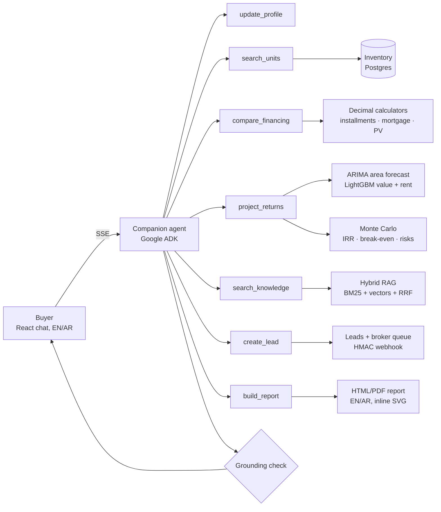

# Real Estate Investment Companion

A bilingual (English / Egyptian Arabic) AI companion for real estate buyers and small investors. It turns a conversation into a decision pack: a shortlist of units, a cash vs. installments vs. mortgage comparison, resale and rental projections as P10 / P50 / P90 ranges, a risk summary, cited answers from company policy documents, a shareable report, and a handoff to a broker.

**Live demo:** UI https://reic-companion.mrwaanawad.workers.dev · API https://reic-companion.fly.dev/health

> **All inventory, market data and documents in this repo are synthetic.** Nothing here is real pricing, a real listing, or investment advice.

## Highlights

- **The LLM never does the math.** Every number in a reply comes from a deterministic tool (Decimal financing calculators, trained models, Monte Carlo). A grounding check compares the figures in each reply against that turn's tool outputs and flags anything it cannot trace.
- **Ranges, not point guesses.** Area forecasts, unit values and returns come with calibrated intervals, and their coverage is measured in backtests.
- **Every model beats a baseline it was gated against.** The area forecast beats seasonal naive (MAPE 5.9% vs 20.4%), and the unit value model beats an area-median baseline (MAE 7.8k vs 17.2k EGP/m²).
- **Arabic is part of the design.** Arabic documents, Arabic eval scenarios, an RTL interface, and Arabic risk text and reports.
- **Built like a production service.** Hexagonal modules enforced by import-linter, 192 backend tests (integration tests on real Postgres), seeded property tests for the financing math, CI on every push, OpenTelemetry, provider fallback with a circuit breaker, rate limits, and HMAC-signed webhooks.
- **Deployed end to end.** Fly.io API, Neon Postgres, Cloudflare static UI.

## How it works



A typical turn: the buyer says *"I have 5M EGP and want to rent it out in New Cairo for 5 years."* The agent saves goal, budget, area and horizon to the profile, searches units within budget, compares the three payment routes on the best fit, and projects value and rent over 5 years. The UI then shows each result as an artifact (shortlist, financing table, fan chart, risk list) next to a short explanation. If the budget or goal is missing, the agent asks before it searches.

## The pieces

| Module | What it does | Method |
| --- | --- | --- |
| `companion` | Chat agent, buyer profile, clarification policy, grounding check, SSE streaming | Google ADK `LlmAgent` with 7 function tools. Provider chain Anthropic → Gemini with a circuit breaker, 60 s timeout and retries on 429/5xx. Scripted `FakeLlm` for tests and offline demos |
| `inventory` | Unit search and goal-weighted shortlist | SQL filters + a scoring function per goal (live / rent / resell) |
| `financing` | Installments, mortgage, present-value comparison | Pure `Decimal` math, checked against reference values and seeded property tests |
| `market` | Area price forecast, unit value, rent | ARIMA(1,1,0) with drift on log prices and a rolling-origin backtest. LightGBM quantile regression (P10/P50/P90) widened by split conformal and promoted only if it beats the baseline. LightGBM rent model |
| `scenarios` | Value, rent, IRR, break-even, sensitivity | NumPy Monte Carlo over price growth (log-normal), inflation and vacancy (beta), plus a sensitivity table. Rule-based risk summary in EN/AR |
| `knowledge` | Cited answers from policy documents | BM25 + vectors (hashing / MiniLM / bge-m3) fused with reciprocal rank fusion. 16 EN/AR docs |
| `handoff` | Broker leads | Leads table, broker queue behind `X-API-Key`, webhook signed with HMAC-SHA256 over `timestamp.body` |
| `reports` | Shareable report | Jinja2 HTML in EN/AR (RTL) with inline SVG charts. PDF through WeasyPrint (works in the deployed image, Arabic included; locally it needs GTK) |

Each module follows `domain / ports / application / adapters`. import-linter enforces 6 contracts: layers point inward, modules don't import each other, and domain/application code stays free of frameworks and vendors (no Litestar, SQLAlchemy, LightGBM or Google imports in the core). Cross-module calls go through gateways in `src/reic/bootstrap/`.

## Evaluation

All numbers are real runs on synthetic data. Raw results are in `evals/results/`; regenerate them with `scripts/train_market_models.py`, `scripts/eval_rag.py` and `scripts/eval_agent.py`.

| Area | Metric | Result |
| --- | --- | --- |
| Area price forecast (ARIMA, rolling origin, 12 areas, 12-month horizon) | MAPE | **5.9%** (seasonal naive 20.4%) |
| | MASE | **0.94** (seasonal naive 3.03) |
| | 80% interval coverage | **0.77** (seasonal naive 0.32) |
| Unit value (LightGBM quantile, EGP/m²) | Holdout MAE | **7,807** (baseline 17,176) |
| | 80% interval coverage after conformal | 0.74 |
| Rent (LightGBM) | Holdout MAE / MAPE | 6,587 EGP / 10.2% |
| RAG (26 questions, EN+AR, k=4, hashing embedder) | Recall@4, BM25 / vector / hybrid | 1.00 / 1.00 / 1.00 |
| | MRR, BM25 / vector / hybrid | 0.981 / 0.923 / 0.962 |
| Agent (10 scenarios, scripted provider) | Task success | 0.90 |
| | Clarification when budget missing | 1.00 |
| | Grounding (no untraced figures) | 1.00 |
| Agent (10 scenarios, live `gemini-3.1-flash-lite`) | Task success | 0.60 |
| | Clarification when budget missing | 1.00 |
| | Grounding (no untraced figures) | 0.70 |
| | Mean seconds per scenario | 5.3 |

How to read the agent rows:
- **Scripted provider:** this row tests the tools, streaming and guardrails, not language-model quality. Its one miss is an Arabic rent request (Madinaty, 4M EGP) that has no matching synthetic unit.
- **Live `flash-lite`:** the small model clarifies and cites well, but it often stops after the shortlist and sometimes states figures no tool returned. The grounding check catches and flags those, which is why the score is measured.
- **`gemini-3.5-flash`:** it completed the full English buyer journey (profile → search → financing → returns, all artifacts) in about 21 s in the live smoke test. Its full 10-scenario eval did not fit the free tier (5 requests/minute, 20/day). With a key that allows it, run `scripts/eval_agent.py --provider gemini --pause 15`.

Tests: 192 backend tests (unit, API, seeded property tests, integration on embedded Postgres) and 10 frontend tests. `scripts/smoke_e2e.py` runs the full journey against a running stack: English buyer journey, knowledge answer with citations, HTML report, broker handoff with queue auth, and an Arabic session.

## Quickstart

```
uv sync --all-extras
python scripts/dev_stack.py --provider fake     # embedded Postgres, migrations, seed, API on :8000
cd frontend && npm install && npm run dev       # UI on :5173
python scripts/smoke_e2e.py                     # end-to-end check against the running API
```

You don't need Docker, a Postgres install or an API key: `dev_stack.py` starts an embedded Postgres, and the `fake` provider is scripted. Use `--provider gemini` (with `GEMINI_API_KEY`) for the real model.

Checks: `uv run ruff check . && uv run ruff format --check . && uv run lint-imports && uv run pytest`.

## Configuration

- **LLM:** set `LLM_PROVIDER` to `fake` (default), `gemini` (`GEMINI_API_KEY`, `GEMINI_MODEL`, default `gemini-3.5-flash`) or `anthropic` (`ANTHROPIC_API_KEY`, `ANTHROPIC_MODEL`). In `anthropic` mode, Gemini is the fallback when a Gemini key exists.
- **Financing assumptions:** discount rate 22%, mortgage 24% over 10 years with 20% down, inflation 15%. They are settings, and the outputs show them.
- **Abuse protection:** `RATE_LIMIT_PER_MINUTE` (default 20) applies per client to `POST /leads` and chat session/message creation. `CLIENT_IP_HEADER` names a trusted proxy header (`Fly-Client-IP` on Fly.io).
- **Broker handoff:** `BROKER_API_KEY` guards the broker queue. `WEBHOOK_URL` + `WEBHOOK_SECRET` turn on the signed lead webhook (`X-REIC-Signature: sha256=<hex>`, `X-REIC-Timestamp`).
- **Observability:** `OTEL_ENABLED=true` traces every HTTP request with OpenTelemetry (OTLP export).

See `.env.example` for every setting.

## API

- `GET /health`
- `POST /chat/sessions`, `POST /chat/sessions/{id}/messages` (SSE), `GET /chat/sessions/{id}/profile`
- `GET /reports/{session_id}?lang=en|ar&format=html|pdf`
- `POST /financing/installments`, `/financing/mortgage`, `/financing/compare`
- `POST /inventory/search`, `/inventory/shortlist`; `GET /inventory/units/{code}`, `/inventory/areas`
- `GET /market/areas/{area_id}/forecast`; `POST /market/unit-value`, `/market/rent`
- `POST /scenarios/simulate`, `/scenarios/risk`
- `GET /knowledge/search`
- `POST /leads`; `GET /broker/leads`, `PATCH /broker/leads/{id}` (header `X-API-Key`)

## Deploy

| Part | Where | Notes |
| --- | --- | --- |
| API | Fly.io app `reic-companion` (Frankfurt) | `Dockerfile` + `fly.toml`, remote builder, `/health` check, machines auto-stop. The container runs `alembic upgrade head` and then the API |
| Database | Neon Postgres (Frankfurt) | Seeded with `scripts/seed.py` |
| UI | Cloudflare Workers static assets | `frontend/wrangler.jsonc`, SPA fallback |

API: set secrets with `fly secrets set DATABASE_URL=... GEMINI_API_KEY=... BROKER_API_KEY=... CORS_ORIGINS=...`, then run `fly deploy --remote-only`. The image leaves out the `forecast` (Prophet) and `retrieval` (sentence-transformers) extras to stay small.

UI: from `frontend/`, run `VITE_API_URL=<API URL> npm run build`, then `npx wrangler deploy`. Add the UI origin to `CORS_ORIGINS`.

The live demo runs on a free-tier Gemini key, so chat stops for the day after about 20 model requests. Every other endpoint keeps working.

## Stack

Python 3.12 · uv · Litestar · Pydantic · SQLAlchemy 2 + Alembic · PostgreSQL (pgvector-ready) · Google ADK · Gemini / Claude (LiteLLM) · LightGBM · statsmodels · scikit-learn · NumPy · Jinja2 + WeasyPrint · OpenTelemetry · React 19 + TypeScript + Vite · i18next (EN/AR, RTL) · Plotly.js · pytest · ruff · import-linter · GitHub Actions · Fly.io · Neon · Cloudflare

## Limitations

- Synthetic data only. Projections are illustrative and not advice.
- Backtests use 3 origins per area on a short synthetic series, so the metrics are optimistic about real markets.
- The RAG eval uses the hashing embedder on a small corpus, and the gold set is easy.
- Live agent numbers so far are from `gemini-3.1-flash-lite`. A full `gemini-3.5-flash` eval needs a paid-tier key.
- Chat sessions and the knowledge index live in memory (single machine). Rate limits use an in-memory store.
- The container has no Prophet or sentence-transformers, so it uses the hashing embedder unless `retrieval` is added.
